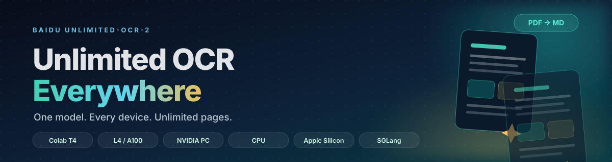

<div align="center">
  
</div>

<h1 align="center">Unlimited OCR Everywhere</h1>

<p align="center">
  <b>One model. Every device. Unlimited pages.</b><br/>
  Run Baidu's <a href="https://github.com/baidu/Unlimited-OCR"><b>Unlimited-OCR-2</b></a> on a free Colab T4,
  Colab Pro L4/A100, a Windows/Linux NVIDIA PC, a CPU-only laptop, or Apple Silicon.
  Download one notebook, run all, get clean Markdown from any PDF.
</p>

<p align="center">
  <a href="https://colab.research.google.com/github/__OWNER__/__REPO__/blob/main/notebooks/Unlimited_OCR_Colab_T4.ipynb">
    
  </a>
  <a href="https://colab.research.google.com/github/__OWNER__/__REPO__/blob/main/notebooks/Unlimited_OCR_Colab_L4_A100.ipynb">
    
  </a>
  
  
  
  
  <a href="https://arxiv.org/abs/2610.39308"></a>
</p>

> **Unofficial community project.** Not affiliated with Baidu. The model, paper and upstream code are by the
> [Baidu ERNIE Team](https://github.com/baidu/Unlimited-OCR) and are MIT-licensed. This repo packages the model
> into notebooks that work on ordinary hardware, with clear memory limits and honest fallbacks.

---

## Pick your notebook

| Notebook | Hardware | Memory | What it is good for |
|---|---|---|---|
| [](https://colab.research.google.com/github/__OWNER__/__REPO__/blob/main/notebooks/Unlimited_OCR_Colab_T4.ipynb) <br/> [**Colab T4**](notebooks/Unlimited_OCR_Colab_T4.ipynb) | Free Google Colab, Tesla T4 | 16 GB VRAM | **Start here.** Zero install. One page per request, float16. |
| [](https://colab.research.google.com/github/__OWNER__/__REPO__/blob/main/notebooks/Unlimited_OCR_Colab_L4_A100.ipynb) <br/> [**Colab L4 / A100**](notebooks/Unlimited_OCR_Colab_L4_A100.ipynb) | Colab Pro, L4 or A100 | 24–80 GB VRAM | BF16, larger chunks, long documents. |
| [**Local NVIDIA GPU**](notebooks/Unlimited_OCR_Local_GPU.ipynb) | Windows or Linux PC, RTX 3060 12 GB and up | 12 GB+ VRAM | Your files, your GPU, no upload limits. |
| [**Local CPU**](notebooks/Unlimited_OCR_Local_CPU.ipynb) | Any x86-64 / ARM64 laptop | 16 GB+ RAM | A few pages without a GPU. 🧪 Experimental. |
| [**Apple Silicon**](notebooks/Unlimited_OCR_Apple_Silicon.ipynb) | M1 / M2 / M3 / M4 Mac | 16 GB+ unified | Local Mac inference via MPS. 🧪 Experimental. |
| [**SGLang Server**](notebooks/Unlimited_OCR_SGLang_Server.ipynb) | Linux + NVIDIA A100/H100 | 24 GB+ VRAM | Hundred-page books, streaming, concurrency. |

<p align="center">
  <sub>Every notebook is self-contained. Download a single <code>.ipynb</code> and run it — no clone required.</sub>
</p>

**Direct downloads:**
[T4](https://github.com/__OWNER__/__REPO__/raw/main/notebooks/Unlimited_OCR_Colab_T4.ipynb) ·
[L4/A100](https://github.com/__OWNER__/__REPO__/raw/main/notebooks/Unlimited_OCR_Colab_L4_A100.ipynb) ·
[Local GPU](https://github.com/__OWNER__/__REPO__/raw/main/notebooks/Unlimited_OCR_Local_GPU.ipynb) ·
[Local CPU](https://github.com/__OWNER__/__REPO__/raw/main/notebooks/Unlimited_OCR_Local_CPU.ipynb) ·
[Apple Silicon](https://github.com/__OWNER__/__REPO__/raw/main/notebooks/Unlimited_OCR_Apple_Silicon.ipynb) ·
[SGLang](https://github.com/__OWNER__/__REPO__/raw/main/notebooks/Unlimited_OCR_SGLang_Server.ipynb)

### Which tier should I use?

- **I just want to try it.** → **Colab T4.** Free, no install, works today.
- **I have an NVIDIA GPU in my PC.** → **Local NVIDIA GPU.** Fastest path for private files.
- **My document is 50+ pages.** → **Colab L4/A100** or **SGLang Server** if you have a Linux GPU box.
- **I only have a laptop.** → **Colab T4** if you have internet; **Local CPU** or **Apple Silicon** if you must stay offline.
- **I need to process a folder of PDFs every day.** → **Local NVIDIA GPU** with the CLI, or **SGLang Server**.

---

## What it does

Unlimited-OCR-2 is a 3B vision-language model for document parsing. It reads page images and emits a structured
layout stream: titles, paragraphs, tables, formulas, figures and bounding boxes. The notebooks then:

1. Render every PDF page to a JPEG (or accept PNG/JPG/TIFF input directly).
2. Send one or more pages to the model, using cross-page context when possible.
3. Convert the raw layout stream to Markdown with the upstream post-processor.
4. Crop figures into an `assets/` folder and rewrite the Markdown links.
5. Write metadata and a batch summary so long runs are easy to audit.

```
output/
├── document.md            # clean Markdown with headings, tables, figures
├── document.raw.txt       # raw model layout stream (debugging / evaluation)
├── document.meta.json     # pages, timings, token counts, finish_reason
├── document.assets/       # cropped figures referenced by document.md
└── run_summary.json       # ok / skipped / failed counts for the batch
```

A converted document looks like this (illustrative):

```markdown
# Quarterly Report

## Revenue

Revenue grew 18% year over year, driven by the document AI segment.

<table>
  <tr><th>Quarter</th><th>Revenue</th><th>Growth</th></tr>
  <tr><td>Q1</td><td>$1.2M</td><td>+12%</td></tr>
  <tr><td>Q2</td><td>$1.4M</td><td>+18%</td></tr>
</table>


```

Tables stay as HTML so merged cells and cross-page fragments survive. Figures are
cropped from the rendered page and linked from the Markdown.

---

## Quick start: Google Colab (free T4)

1. Click the **Open in Colab** badge for the T4 notebook.
2. **Runtime → Change runtime type → Hardware accelerator → GPU → T4**.
3. **Runtime → Run all**.
4. Wait for **WAITING FOR FILES**, then upload PDFs or images to `input/`.
5. The notebook writes Markdown to `output/` and downloads a ZIP when it finishes.

The first run downloads about **7 GB** of model weights. Expect 10–20 minutes on a fast connection.

> Colab's `/content` storage is temporary. Set `USE_DRIVE = True` in the configuration cell to keep
> `input/` and `output/` in Google Drive.

---

## Quick start: local NVIDIA GPU

```bash
git clone https://github.com/__OWNER__/__REPO__.git
cd __REPO__

python -m venv .venv
source .venv/bin/activate          # Windows: .venv\Scripts\activate

# Pick the PyTorch wheel that matches your driver, then install the rest:
pip install torch torchvision --index-url https://download.pytorch.org/whl/cu124
pip install -r requirements/base.txt

jupyter lab
```

Open `notebooks/Unlimited_OCR_Local_GPU.ipynb`, run all cells, and put files in `input/`.

Or skip the notebook entirely:

```bash
python scripts/ocr_pdf.py --input my.pdf
python scripts/ocr_pdf.py --input scans/ --output out --mode auto --zip
python scripts/ocr_pdf.py --input book.pdf --chunk-pages 4 --dpi 250
```

---

## Quick start: CPU-only laptop (experimental)

```bash
python -m venv .venv
source .venv/bin/activate
pip install torch torchvision --index-url https://download.pytorch.org/whl/cpu
pip install -r requirements/base.txt

python scripts/check_environment.py
jupyter lab
```

Open `notebooks/Unlimited_OCR_Local_CPU.ipynb`. Expect **minutes to hours per page**, not seconds. The notebook
defaults to one page per request, 150 DPI and a 5-page cap. A free Colab T4 is dramatically faster if you can use it.

---

## Quick start: Apple Silicon (experimental)

```bash
python3 -m venv .venv
source .venv/bin/activate
pip install torch torchvision
pip install -r requirements/base.txt

python scripts/check_environment.py   # should print "MPS available: True"
jupyter lab
```

Open `notebooks/Unlimited_OCR_Apple_Silicon.ipynb`. MPS support is experimental: 16 GB of unified memory is the
minimum, 32 GB is comfortable, and `MODE="base"` with one page per request is the reliable setting.

---

## Hardware support at a glance

| Tier | Minimum | Recommended | Default mode | Status |
|---|---|---|---|---|
| Colab T4 | 16 GB VRAM | 16 GB VRAM | base / float16, 1 page | ✅ Supported |
| Colab L4 | 24 GB VRAM | 24 GB VRAM | auto / bfloat16, 8 pages | ✅ Supported |
| Colab A100 | 40 GB VRAM | 80 GB VRAM | auto / bfloat16, whole doc | ✅ Supported |
| Local NVIDIA | 12 GB VRAM | 24 GB+ VRAM | auto / auto chunk | ✅ Supported |
| Local CPU | 16 GB RAM | 32 GB+ RAM | base / float32, 1 page | 🧪 Experimental |
| Apple Silicon | 16 GB unified | 32 GB+ unified | base / float16, 1 page | 🧪 Experimental |
| SGLang server | 24 GB VRAM, Linux | A100 / H100 | gundam, 10-page windows | ✅ Production path |

**The practical minimum is 12 GB of VRAM.** The BF16 weights alone are about 6.7 GB; activations, the vision encoder
and the KV cache need the rest. An 8 GB card can sometimes parse a single page in `base` mode, but it is not a
comfortable experience.

---

## Configuration cheat sheet

Every notebook exposes the same settings in the configuration cell:

| Setting | Default | What it does |
|---|---|---|
| `MODE` | `auto` | `auto` picks `base` for multi-page / low VRAM and `gundam` for single pages on a large GPU. `base` = one global view (lowest memory). `gundam` = tiled views (most detail). |
| `CHUNK_PAGES` | `0` / tier-specific | Pages per model request. `0` chooses from available memory. Lower it if you hit OOM. |
| `DPI` | 200–250 | PDF render resolution. 200 is a good default; 300 is slower and uses more memory. |
| `MAX_PAGES` | `0` or tier-specific | `0` = all pages. Set a number to cap a very long document. |
| `MAX_TOKENS_PER_PAGE` | 4000–8000 | Output budget per page. Raise it if a page is cut off. |
| `MAX_PAGE_TOKENS` | 20000 | Per-page guard used by the model's page-count logic. |
| `FORCE_DTYPE` | `auto` | `auto` picks BF16 on Ampere+, FP16 on T4/Turing, FP32 on CPU. |
| `USE_TRITON` | `True` | CUDA-only fused kernels. Set `False` if you see Triton errors. |
| `FORCE` | `False` | Reprocess documents whose `.md` already exists. |
| `KEEP_PAGES` | `False` | Keep rendered page JPEGs in `output/.work/`. |
| `USE_DRIVE` | `False` | Colab only: keep `input/` and `output/` in Google Drive. |

### Memory tuning, in order

1. `MODE = "base"` — the single biggest win.
2. `CHUNK_PAGES = 1` — process one page per request.
3. `DPI = 150` — smaller page images.
4. `MAX_TOKENS_PER_PAGE = 4000` — shorter output budget.
5. Use a larger GPU or the SGLang path.

The notebooks retry automatically: when a request runs out of memory, they split the page group in half and try again.

---

## The notebooks

### `Unlimited_OCR_Colab_T4.ipynb`

The default starting point. Tesla T4, 16 GB, float16 (Turing has no native BF16), one page per request.
Includes Drive mounting, automatic ZIP download, and a T4-specific troubleshooting section.

### `Unlimited_OCR_Colab_L4_A100.ipynb`

Colab Pro. L4 (24 GB) or A100 (40/80 GB), BF16, 250 DPI, eight pages per request by default.
Set `CHUNK_PAGES = 0` on an 80 GB A100 to parse a whole document in one request.

### `Unlimited_OCR_Local_GPU.ipynb`

Windows or Linux with an NVIDIA GPU. Auto-detects CUDA, picks BF16/FP16, and chooses a safe chunk size from VRAM.
Includes Windows/WSL2 and CUDA-wheel notes.

### `Unlimited_OCR_Local_CPU.ipynb`

A CPU-only fallback. Float32, one page, 150 DPI, five-page cap. Honest warning: this is experimental and slow.
The notebook patches the model's hard-coded `.cuda()` calls so it can run on CPU.

### `Unlimited_OCR_Apple_Silicon.ipynb`

Apple Silicon via MPS. Disables CUDA-only Triton kernels and enables the MPS CPU fallback. Experimental:
16 GB unified memory is the minimum, 32 GB is comfortable. If an op is unsupported, PyTorch falls back to the CPU.

### `Unlimited_OCR_SGLang_Server.ipynb`

The production path. Creates a Python 3.10 `uv` virtualenv, installs the customized SGLang wheel, starts the server
with the upstream page-window flags, waits for health, and sends whole PDFs as streaming requests. Includes a stop
cell and memory-tuning advice. Linux + NVIDIA 24 GB+ recommended.

---

## CLI

`scripts/ocr_pdf.py` is a standalone batch converter with the same output format as the notebooks.

```bash
# One PDF, all pages, automatic device and mode
python scripts/ocr_pdf.py --input paper.pdf

# A folder tree, 250 DPI, CPU
python scripts/ocr_pdf.py --input scans/ --output out --device cpu --dpi 250

# Long book on a big GPU, four pages per request, keep page images, create a ZIP
python scripts/ocr_pdf.py --input book.pdf --chunk-pages 4 --keep-pages --zip

# Single image, base mode, no Triton
python scripts/ocr_pdf.py --input page.png --mode base --no-triton
```

Run `python scripts/ocr_pdf.py --help` for every flag.

### Environment check

```bash
python scripts/check_environment.py
```

It prints Python, OS, RAM, PyTorch, CUDA devices and VRAM, MPS availability, installed versions, and which notebook
fits your machine. It does not download the model.

---

## SGLang server (long documents, production)

The SGLang backend is the recommended path for hundred-page documents and batch throughput. It adds page-window
scheduling, streaming, concurrent requests and the custom n-gram logit processor used in the paper's evaluation.

**Use the [SGLang notebook](notebooks/Unlimited_OCR_SGLang_Server.ipynb)** for the guided path. For a manual setup:

```bash
# Linux + NVIDIA, Python 3.10, uv
uv venv --python 3.10
source .venv/bin/activate
uv pip install wheel/sglang-0.5.20.dev13+g75b9b06b02-py3-none-any.whl
uv pip install pymupdf==1.27.2.2 fastokens==0.3.2

./scripts/start_sglang_server.sh
```

The script sets the upstream memory flags (`SGLANG_UOCR_EANABLE_DOC_LIMIT=1`, 10-page windows,
`SGLANG_OPT_UOCR_SAM_REL_POS_BIAS_MB=64`, `expandable_segments:True`) and launches the server on port 10000.
The client sends PDFs to the OpenAI-compatible `/v1/chat/completions` endpoint and saves Markdown.

> The customized wheel is required. The stock `pip install sglang` does not include the Unlimited-OCR-2 chat
> template and logit processor.

---

## Troubleshooting

| Symptom | Fix |
|---|---|
| `No GPU detected` | Colab: **Runtime → Change runtime type → GPU**. Local: install the CUDA PyTorch wheel; run `python scripts/check_environment.py`. |
| `CUDA out of memory` | `MODE="base"`, `CHUNK_PAGES=1`, lower `DPI`, lower `MAX_TOKENS_PER_PAGE`. The notebook also auto-splits requests. |
| T4 says BF16 is not supported | Expected. Turing has no native BF16; the notebook uses float16 and patches image preprocessing. |
| Triton / custom kernel error | Set `USE_TRITON=False`, restart the runtime/kernel, run all. |
| `transformers` version error | The notebook pins `transformers==4.52.1`. Restart the runtime/kernel after install. |
| Output is cut off | `name.meta.json` has `"truncated": true`. Raise `MAX_TOKENS_PER_PAGE` or lower `CHUNK_PAGES`. |
| Colab disconnected, files gone | Enable `USE_DRIVE=True`, or download the ZIP before the runtime ends. |
| CPU process killed | Out of RAM. Lower `MAX_PAGES`, `DPI` and `MAX_TOKENS_PER_PAGE`; 16 GB is the minimum. |
| Apple MPS OOM | Restart the kernel, use `MODE="base"`, `CHUNK_PAGES=1`, lower `DPI`. |
| SGLang server exits | Check `sglang_server.log`; verify `nvidia-smi`, port 10000, and the customized wheel. |

More detail: [docs/TROUBLESHOOTING.md](docs/TROUBLESHOOTING.md).

---

## FAQ

**Is this affiliated with Baidu?**
No. It is an unofficial packaging project. The model, paper and upstream code are by the Baidu ERNIE Team.
If you use the model in research, cite the original papers (see below).

**Do I need to clone the repo to use a notebook?**
No. Each notebook is self-contained. Download the `.ipynb` and run it. The repo is only needed for the CLI,
the vendored post-processor, and development.

**Does it work on Windows?**
Yes. Native Windows works; WSL2 with an NVIDIA driver is the most reliable setup. The Local GPU notebook
includes Windows-specific notes.

**Does it work on a Mac?**
There is an experimental Apple Silicon notebook using MPS. It works for small documents on 16 GB+ machines,
but it is not the primary path. A CUDA GPU is faster.

**Does it work without a GPU?**
Yes, experimentally. A 3B model in float32 needs roughly 12 GB of RAM for the weights. Expect minutes to hours
per page. Use the CPU notebook for a few pages, not a book.

**Does it need internet?**
The first run downloads the model (~7 GB) and Python packages. After that, inference is local. On Colab,
everything runs in Google's cloud.

**Does it handle scanned PDFs?**
Yes. Pages are rendered to images, so scans and photos work. Text-layer PDFs also work; the model reads the
rendered page, not the embedded text.

**Are tables preserved?**
Tables are converted to HTML inside the Markdown. Cross-page tables are merged by the upstream post-processor.
Figures are cropped into `document.assets/`.

**Can I use it commercially?**
The upstream model and code are MIT-licensed. Check the upstream repository and model card for the definitive
terms. This packaging repo is also MIT.

**Why is the first page slow?**
Model loading and the first forward pass happen once. Later pages reuse the loaded model.

**Why does the free T4 struggle with long books?**
16 GB of VRAM is the minimum. Each page adds vision tokens and KV cache. Use `CHUNK_PAGES=1` for reliability,
or move to L4/A100/SGLang for long documents.

---

## Repository map

```
.
├── notebooks/                  # six self-contained notebooks
│   ├── Unlimited_OCR_Colab_T4.ipynb
│   ├── Unlimited_OCR_Colab_L4_A100.ipynb
│   ├── Unlimited_OCR_Local_GPU.ipynb
│   ├── Unlimited_OCR_Local_CPU.ipynb
│   ├── Unlimited_OCR_Apple_Silicon.ipynb
│   └── Unlimited_OCR_SGLang_Server.ipynb
├── scripts/
│   ├── ocr_pdf.py              # batch CLI
│   ├── check_environment.py    # hardware / dependency report
│   └── start_sglang_server.sh  # production server launcher
├── requirements/               # base / gpu / cpu / colab / sglang / dev
├── vendor/
│   └── process_unlimitedOCR2.py  # upstream post-processor (MIT, vendored)
├── docs/                       # install, hardware, Colab, SGLang, FAQ
├── assets/                     # banner and social preview
├── examples/                   # a tiny sample PDF
├── archive/                    # original single-notebook version (preserved)
├── CHANGELOG.md
├── CITATION.cff
├── tools/
│   ├── build_notebooks.py      # regenerates all notebooks from templates
│   ├── validate_notebooks.py   # CI: JSON + Python syntax check
│   └── personalize.py          # replaces __OWNER__ / __REPO__ links
└── .github/                    # issue templates, PR template, CI
```

---

## Personalize the links

If the Colab badges or absolute links still point at a placeholder, run this once from the repo root:

```bash
python tools/personalize.py --owner YOUR_GITHUB_USERNAME --repo unlimited-ocr-everywhere
```

Then commit the result. The script updates the README, all six notebooks, `CITATION.cff` and the docs.
It leaves the validator and this file's placeholders intact so the tooling keeps working.
The preferred repo name, description, topics and social-preview copy are in
[`REPO_NAME_AND_DESCRIPTION.txt`](REPO_NAME_AND_DESCRIPTION.txt).

---

## Contributing

Contributions are welcome: new hardware tiers, bug fixes, clearer error messages, better docs.
Read [CONTRIBUTING.md](CONTRIBUTING.md) and open an issue using the templates.

If you find a hardware/software combination that works, please add it to the
[hardware report issue](.github/ISSUE_TEMPLATE/hardware_report.yml). Real-world reports make the
"supported" column more honest.

---

## Credits

This project stands on the work of the **Baidu ERNIE Team** and the open-source community:

- [baidu/Unlimited-OCR](https://github.com/baidu/Unlimited-OCR) — model, code, paper, evaluation utilities
- [baidu/Unlimited-OCR-2](https://huggingface.co/baidu/Unlimited-OCR-2) — model weights
- [DeepSeek-OCR](https://github.com/deepseek-ai/DeepSeek-OCR) and [DeepSeek-OCR-2](https://github.com/deepseek-ai/DeepSeek-OCR-2) — ideas and architecture
- [PaddleOCR](https://github.com/PaddlePaddle/PaddleOCR) — OCR foundations
- [SGLang](https://github.com/sgl-project/sglang) — serving framework
- [MarathonDocBench](https://huggingface.co/datasets/baidu/MarathonDocBench) — long-document benchmark

### Citation

```bibtex
@misc{wei2026unlimitedocrworks2,
      title={Unlimited OCR Works 2},
      author={Baidu ERNIE Team},
      year={2026},
      eprint={2610.39308},
      archivePrefix={arXiv},
      primaryClass={cs.CL},
      url={https://arxiv.org/abs/2610.39308},
}

@misc{yin2026unlimitedocrworks,
      title={Unlimited OCR Works},
      author={Baidu ERNIE Team},
      year={2026},
      eprint={2606.23050},
      archivePrefix={arXiv},
      primaryClass={cs.CV},
      url={https://arxiv.org/abs/2606.23050},
}
```

---

## License

MIT. See [LICENSE](LICENSE).

The vendored `vendor/process_unlimitedOCR2.py` is from the upstream Unlimited-OCR repository (MIT) and retains
its original header. Model weights are distributed by Baidu under the model card's terms.

---

<p align="center">
  <sub>If this saves you a day of setup, star the repo and tell someone who has a PDF mountain.</sub>
</p>
